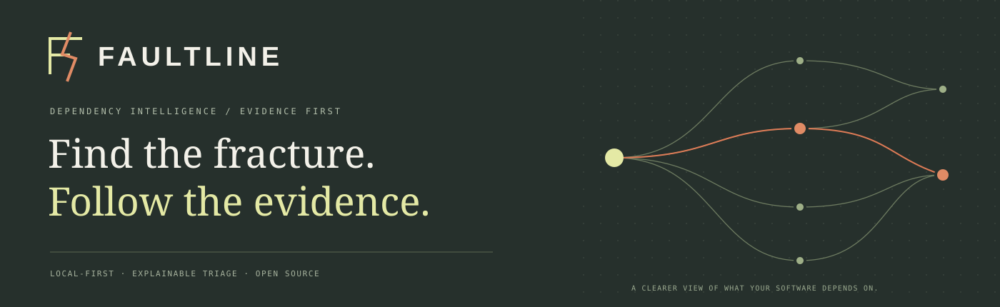
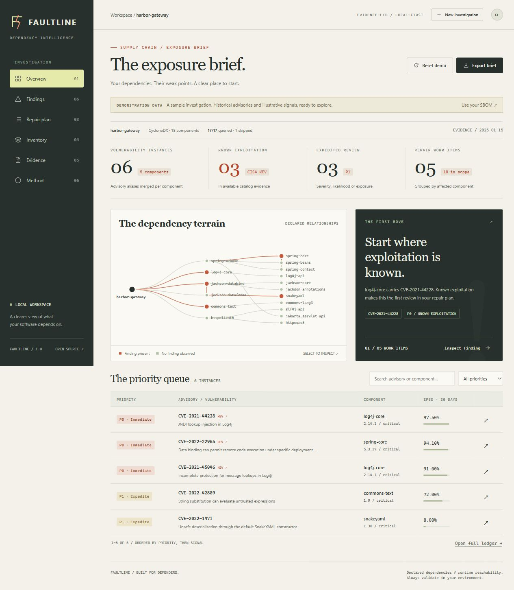

# Faultline

**A local investigation desk for software dependency vulnerabilities.**

Faultline turns a software bill of materials into a defensible repair queue. Import a CycloneDX or SPDX document, enrich exact package versions with OSV advisories, CISA KEV and FIRST EPSS, then inspect the evidence behind every priority. Take the same engine into CI, or replay a saved evidence capsule without network access.

Built in strict TypeScript. **Zero runtime dependencies.** No accounts, database, API keys, vulnerable packages, or cloud deployment required. The browser interface runs on your machine.



## Start in three commands

Install **Node.js 24 or later**, then:

```sh
git clone https://github.com/InazumaShogun/Faultline.git
cd Faultline
npm ci && npm run build && npm start
```

Open **http://127.0.0.1:4317**. A clearly labeled, offline demonstration opens immediately. No outbound intelligence calls happen until you opt in. Windows users can run `start.cmd`; macOS/Linux users can run `sh start.sh`.

The Windows launcher opens your default browser once the app is ready. If Faultline is already running, it reuses that instance. If another application occupies the default port, it selects a free local port and prints the actual address. Startup errors remain visible in the launcher window.

Extract the **entire ZIP** before running `start.cmd`; opening it directly inside the compressed folder can leave the rest of the project unavailable. Keep the server window open while using Faultline. If startup fails, copy the error shown above the pause prompt. An explicit `PORT` setting is respected; clear it or choose another value if that port is occupied by a different application.

The downloadable prebuilt package includes `dist/`, so only Node.js is needed to run it. A source checkout builds with `npm ci` and `npm run build`.

### Or use Docker

```sh
docker build -t faultline .
docker run --rm --read-only --cap-drop=ALL --security-opt=no-new-privileges -p 127.0.0.1:4317:4317 faultline
```

The image runs as a non-root user and contains no development dependencies. Keep the published port on loopback: Faultline is a personal workbench, without multi-user authentication. Docker configuration is supplied; see [validation](docs/VALIDATION.md) for what was actually exercised.

## A useful investigation, end to end

1. **Import an inventory.** CycloneDX 1.4–1.7 or SPDX 2.2/2.3 JSON, with versioned Package URLs. The supplied `examples/` contain both formats.
2. **Declare context.** Exposure and business criticality are analyst inputs; they are never inferred from a package graph.
3. **Choose intelligence.** Live mode sends package names/versions to OSV and CVE IDs to FIRST, and downloads CISA's full KEV catalog. Offline mode replays a previously exported capsule.
4. **Investigate a finding.** Inspect aliases, source links, priority rationale, shortest declared dependency path, upstream dependents, and package-specific fixed version candidates.
5. **Plan the repair.** Work items group findings by component. Check all relevant advisory branches and compatibility, upgrade, test, and rescan.
6. **Export the handoff.** Markdown brief, complete JSON record, SARIF 2.1.0, or a replayable normalized evidence capsule.

The interface uses an editorial visual language: ink, warm paper, pale citron and vermilion; an explorable SVG dependency terrain; keyboard-operable findings; native modal dialogs; responsive layouts; and a print stylesheet. There are no decorative “live” charts or fabricated activity feeds.

## The command line

Build once, then use the same engine without a browser:

```sh
# Live scan with an explicit policy threshold
node dist/src/cli.js analyze examples/harbor.cdx.json --live --fail-on P1 --output report.json --save-evidence evidence.json

# Replay that evidence, without network access
node dist/src/cli.js analyze examples/harbor.cdx.json --evidence evidence.json --format markdown --output brief.md

# SARIF for security tooling
node dist/src/cli.js analyze examples/harbor.cdx.json --evidence evidence.json --format sarif --output findings.sarif.json

# Network-disabled web server
node dist/src/server.js --offline
```

`--exposure internet|internal|unknown` and `--criticality critical|standard` apply the same context as the interface. Output paths are **create-only**, protecting existing reports from accidental overwrite. Use new paths for each investigation.

| Exit | Meaning                                                                      |
| ---- | ---------------------------------------------------------------------------- |
| `0`  | Policy passed for the queried inventory. Review skipped coverage separately. |
| `1`  | A finding met or exceeded `--fail-on`. `P1` includes P0 and P1.              |
| `2`  | Indeterminate: incomplete, stale, future-dated, or demonstration evidence.   |
| `3`  | Input, configuration, or runtime error.                                      |

`--fail-on none` is the default. It still returns `2` for indeterminate evidence. Demo scans intentionally return `2`; demonstration data can never approve a release.

## What makes the result inspectable

| Signal            | What it means                                                  | What it does not establish                                    |
| ----------------- | -------------------------------------------------------------- | ------------------------------------------------------------- |
| OSV version query | An advisory is returned for a specific package/version         | That vulnerable code is invoked by this application           |
| CISA KEV match    | A CVE appears in the available exploited-vulnerability catalog | Exploitation of this particular deployment                    |
| FIRST EPSS        | A CVE's estimated exploitation probability over 30 days        | Application compromise probability; percentile is only a rank |
| Dependency path   | A shortest path through declared SBOM relationships            | Runtime or symbol-level reachability                          |
| Fixed candidate   | An OSV range endpoint for the matched package                  | A compatible or universally safe upgrade target               |
| SHA-256           | Identity of the input bytes or canonical normalized evidence   | Source authenticity or a digital signature                    |

**Policy:** P0 for a KEV match. Otherwise P1 for EPSS ≥ 10%, critical severity, or high severity with declared internet exposure / critical business context. P2 covers remaining high severity and unknown severity. P3 covers lower severity without a stronger available signal. Within a priority, an explicit sorting heuristic orders the queue. This policy is **not an empirically validated risk model**. See [methodology](docs/METHODOLOGY.md).

## Engineering worth inspecting

- Cycle-safe breadth-first traversal gives deterministic shortest dependency paths; reverse traversal measures upstream dependency relationships.
- Union-find merges transitive advisory aliases **per component**, retaining original advisory IDs and distinct package instances.
- OSV batch queries honor **per-query pagination tokens**. Detail retrieval uses a bounded six-worker pool; transient HTTP failures get a limited retry budget.
- Fixed HTTPS intelligence endpoints reject redirects. Requests have timeouts, response limits, and an overall three-minute live collection budget.
- A pure analysis engine separates parsers, intelligence collection, policy, graph operations, and report serialization from HTTP and browser code.
- The local HTTP boundary validates Host and Origin, blocks cross-origin preflight, requires a custom request header, limits concurrent analyses, and serves only an explicit asset allowlist.
- Strict CSP, escaped untrusted text, safe reference URLs, no remote fonts or scripts, and no runtime dependency tree.
- Unit and HTTP integration tests exercise meaningful failure paths, rather than only the demonstration's happy path. CI checks Windows and Linux.

## Supported scope and deliberate limits

Supported Package URL types: **npm, PyPI, Maven, Go, crates.io, NuGet, RubyGems, Packagist, Hex, Pub, SwiftURL**. Unsupported types, missing versions, and missing PURLs appear as coverage gaps. This release reads SBOMs; generate one with your ecosystem tooling, [Syft](https://github.com/anchore/syft), or [cdxgen](https://github.com/CycloneDX/cdxgen).

Limits: 8 MiB JSON inputs / HTTP request envelope; 1,500 components; 15,000 declared edges; 2,000 advisory detail records; 20 pagination rounds per OSV batch; 16 MiB per provider response; two simultaneous HTTP analyses. The graph renders up to 60 components; the inventory and reports preserve all supported components. Snapshot metadata is validated, but an imported capsule remains a statement supplied by its author.

Severity uses CVSS v3.0/v3.1 base vectors where present, otherwise provider severity labels. CVSS v2/v4 vectors are not calculated. Unknown values stay unknown. Advisories may be incomplete, withdrawn, stale, or absent; an empty findings list never certifies software as safe.

No exploit execution, network target scanning, package installation from the SBOM, automatic patching, VEX suppression, call-graph analysis, or compatibility solver is included. The project is intended to complement tools such as OSV-Scanner and Dependency-Track with a focused, portable investigation workflow.

## Development and review

```sh
npm ci
npm run check
npm test
npm run build
npm start
```

Read [architecture and trust boundaries](docs/ARCHITECTURE.md), [methodology](docs/METHODOLOGY.md), [validation and limitations](docs/VALIDATION.md), [security policy](SECURITY.md), and the [presentation walkthrough](docs/DEMO.md). `CONTRIBUTING.md` describes the contribution workflow.

## Research and upstream attribution

The problem selection follows CISA's [SBOM consumption guidance](https://www.cisa.gov/topics/cyber-threats-and-advisories/sbom/sbomresourceslibrary): inventories become useful when connected to vulnerability management and prioritization. The implementation follows the [OSV batch-query API](https://google.github.io/osv.dev/post-v1-querybatch/), [FIRST EPSS API](https://api.first.org/epss/), [CycloneDX dependency semantics](https://cyclonedx.org/use-cases/software-dependencies/), [SPDX relationship semantics](https://spdx.github.io/spdx-spec/v2.3.1/relationships-between-SPDX-elements/), and [FIRST's CVSS v3.1 specification](https://www.first.org/cvss/v3.1/specification-document).

Faultline is an independent project, with no claimed endorsement by those organizations. Live intelligence retains upstream data provenance; upstream data terms apply to that data. Demonstration fixtures contain curated summaries and explicitly illustrative historical signals. The application code is [MIT licensed](LICENSE); no third-party application code is vendored. Development dependency licenses are documented in [THIRD_PARTY.md](THIRD_PARTY.md).
