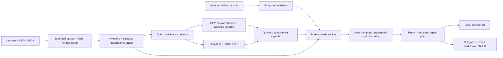

# Architecture and trust boundaries

Faultline is a single-process local application. The browser and CLI share a strict TypeScript analysis engine; the browser does not contact intelligence providers directly.

## Source map

| Module                   | Responsibility                                                                                   |
| ------------------------ | ------------------------------------------------------------------------------------------------ |
| `src/core/model.ts`      | Shared domain types and report/evidence contracts                                                |
| `src/core/validation.ts` | Runtime boundary helpers, safe URLs, deterministic hashes                                        |
| `src/core/input.ts`      | CycloneDX/SPDX adapters and supported Package URL identity                                       |
| `src/core/graph.ts`      | Cycle-safe BFS, reverse dependency traversal, alias union-find                                   |
| `src/core/cvss.ts`       | FIRST CVSS v3.0/v3.1 base calculation                                                            |
| `src/core/evidence.ts`   | OSV pagination, bounded worker pool, KEV/EPSS adapters, snapshot validation                      |
| `src/core/analyze.ts`    | Pure findings construction, explainable policy, grouped repair work, baseline comparison utility |
| `src/core/reports.ts`    | Release-gate semantics, Markdown, SARIF                                                          |
| `src/server.ts`          | Local HTTP boundary and static asset allowlist                                                   |
| `src/cli.ts`             | Headless operation and machine-readable exit codes                                               |
| `src/web/app.ts`         | Accessible browser investigation interface and SVG dependency terrain                            |

The baseline comparison utility is a tested core API; this release does not expose it as a browser or CLI workflow. It matches versionless package identities and overlapping advisory aliases, and describes absent findings as “no longer observed,” not “fixed.”

## Input boundary

All JSON is data. The application never executes scripts, installs packages named by an SBOM, resolves local file references, follows arbitrary URLs, or launches subprocesses from input. There is no templating engine or Markdown renderer for advisory text.

Inventory adapters reject duplicate component IDs and contradictory explicit versions. They preserve unsupported/unqueryable components as coverage gaps. Missing dependency declarations remain unknown. External or missing graph nodes are omitted with warnings. Unsupported document versions fail visibly.

An imported capsule passes structural validation, but its author controls its asserted matches and metadata. It is not authenticated upstream intelligence. The SHA-256 digest identifies normalized content, not origin or truthfulness.

## Network boundary

Live mode has three fixed destinations:

| Destination     | Outbound data                                                   |
| --------------- | --------------------------------------------------------------- |
| `api.osv.dev`   | Ecosystem, package name and exact version; advisory ID requests |
| `api.first.org` | CVE IDs only                                                    |
| `www.cisa.gov`  | GET for the entire public KEV catalog                           |

No user-supplied host is accepted. HTTPS is required, non-default ports and URL credentials are rejected, and redirects fail. Each response is capped at 16 MiB; each fetch has a 20-second signal deadline. Live collection has a three-minute overall abort budget. HTTP 429/5xx responses get at most two retries with bounded backoff. Transport failures produce incomplete evidence rather than implicit success.

OSV requests run in batches of 100. Each query owns its pagination token; completed queries leave the pending set. Repeated tokens and more than 20 rounds fail that batch. Up to six detail requests run concurrently. Collection caps detail records at 2,000 and surfaces missing records as incomplete analysis.

The full SBOM is not uploaded. Package metadata can still be sensitive; live mode requires an explicit user selection and disclosure acknowledgment in the UI. CLI `--live` is the equivalent opt-in. `--offline` disables live collection on the server.

## HTTP boundary

By default the server binds only `127.0.0.1`. Host must be `localhost:<actual port>` or `127.0.0.1:<actual port>`. An Origin, when present, must match one of those loopback origins. Analysis POSTs require JSON and `X-Faultline-Request: 1`; no cross-origin preflight is accepted. Only two analyses may run concurrently.

Static paths are selected from a literal allowlist. Security headers include strict CSP, no framing, `nosniff`, no referrer, and same-origin resource policy. Scripts, styles and fonts are local. All untrusted visible strings are escaped before insertion; provider references are restricted to HTTP(S) URLs without credentials. No telemetry, service worker, persistent browser storage, or application inventory database is used.

Container mode binds `0.0.0.0` inside the container. The documented Docker command publishes only to host loopback. Host validation is defense in depth, not authentication for an externally reachable server. There is no supported internet-facing deployment mode.

## Determinism and complexity

Graph BFS and a single reverse traversal are O(V + E); analysis repeats reverse traversal for affected components. Union-find uses path compression to coalesce transitive aliases. Evidence keys are sorted for canonical hashing. Original input hashes use the exact UTF-8 bytes supplied to the parser. Finding keys include package identity, canonical advisory identity and component ID.

Report generation time is separate from evidence acquisition time. Replaying the same input, context, normalized capsule and analysis timestamp gives the same findings and evidence hash. Priorities may intentionally change when freshness thresholds are crossed.

## Operational boundaries

The application has no authentication, multi-user isolation, persistent task scheduler or automatic patching. The local process keeps results in memory during requests; the browser retains its current investigation until a reload or replacement. Exports are explicit downloads. Reports can expose private inventory information, so storing/sharing them is an analyst decision.

The no-runtime-dependency design reduces supply-chain surface, but it is not a proof of security. The platform, development tools, intelligence providers and input quality remain part of the trust model.
